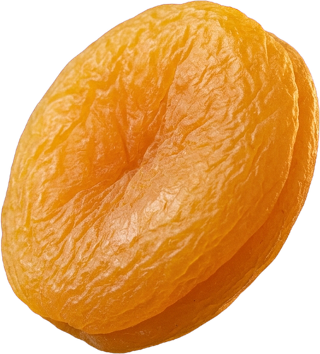
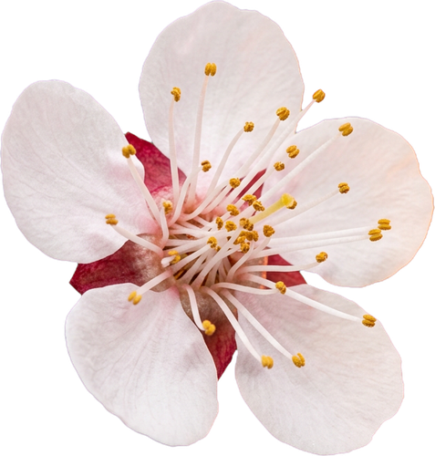

# Ahsen Kayısı — site sözleşmesi

Astro (statik) + vanilla TS + düz CSS. UI framework yok, Tailwind yok.

## Kurallar
- **Bir bölüm = bir içerik dosyası + bir bileşen dosyası.** `src/content/tr/<bolum>.ts` + `src/components/sections/<Bolum>.astro`. Bölüme özel TS: `src/lib/<bolum>/`.
- `src/pages/index.astro`, `src/layouts/Base.astro`, `src/lib/motion/`, `src/styles/` ortaktır: **dokunma**, ihtiyaç varsa orkestratöre bildir.
- **Dev sunucu başlatma, `astro build` çalıştırma.** Yalnızca `npm run check`.
- Türkçe karakterler doğru yazılır (ç ğ ı İ ö ş ü). Metin her zaman içerik dosyasından gelir, bileşene gömülmez.
- Yalnızca `transform / opacity / clip-path / filter` canlandır. `transition: all` yok.

## Klasörler
```
src/content/types.ts          ortak tipler (SectionHeading, Link, Media)
src/content/tr/*.ts           bölüm başına içerik; tipi dosyanın içinde (export interface …)
src/content/index.ts          getContent('tr') — yeni dil = yeni klasör + bir satır
src/components/sections/      Hero, Sergi, Manifesto, Rakamlar, Surec, Urunler, Dunya, Kalite, Iletisim, Footer
src/components/ui/SectionHeading.astro   "03 — Başlık" bileşeni (isteğe bağlı)
src/lib/motion/               data-* ile otomatik kurulan hareket kütüphanesi
src/lib/{hero,sergi,shell}/   sahneye özel betikler
src/styles/tokens.css         renk, tip ölçeği, boşluk, z-index, easing, gökyüzü temaları
src/styles/base.css           reset, tipografi, ızgara, düğmeler, motion yapısal CSS
```

## Medya yolları (public/)
`/seq/hero/` + `/seq/hero-fg/` (manifest.json, f_0001.webp…, mobil `m/`) · `/media/video/v-sergi-drone{,-m}.mp4`, `.jpg` poster ·
`/media/foto/<ad>-{1200,2400}.webp|-1600.avif` · `/media/kesim/<ad>-{500,1000}.webp` (saydam) · liste: `/media/_manifest.json` · logo: `/media/marka/ahsen-logo.png`.

## Bölüm iskeleti ve gökyüzü
```astro
<section id="urunler" class="section" data-sky="bark" aria-labelledby="urunler-title">
  <div class="container">…</div>
</section>
```
`data-sky`: `void · blossom · cream · bone · golden · bark · dusk · night` (değerler tokens.css'te). Sayfa rengi bölümler arasında
akar (`html` üzerindeki `--bg --fg --accent --muted --focus --grain`). Bölüm içinde ikinci durak: `data-sky-to="golden" data-sky-to-range="0.6 0.9"`.
Bileşen stillerinde **sabit renk değil** `var(--fg)`, `var(--muted)`, `var(--accent)`, `var(--line)` kullan. Gövde metni bölümün
üst boşluğuna (`--section-y`) oturmaz — renk geçişi orada olur. Atanmış gökyüzleri: hakkimizda cream · rakamlar bone ·
surec bone→golden · urunler bark · dunya night · kalite dusk · iletisim night · footer night.

## Sabitleme (sticky pin)
```html
<section data-pin style="--pin-len: 200lvh"><div data-pin-stage>…tam ekran sahne…</div></section>
```
ScrollTrigger için tetik: `trigger: section, start: 'top top', end: 'bottom bottom', scrub: true`. Atalarda `overflow:hidden` yok.

## Motion API (kopyala-yapıştır)
```html
<!-- Maskeli açılım: lines | words | chars -->
<h2 data-reveal="lines">Tek meyve, beş hâl.</h2>
<p data-reveal="words" data-reveal-delay="0.2">…</p>
<!-- Sabit sahne içinde: bölüm ilerlemesinin %35'inde -->
<h3 data-reveal="lines" data-reveal-trigger="#surec" data-reveal-start="35%">…</h3>

<!-- Kaydırdıkça renkle dolan metin -->
<p class="t-lead" data-fill data-fill-start="top 80%" data-fill-end="bottom 45%">…</p>

<!-- Sayaç (HTML'e son değeri yaz; tr-TR biçimi) -->
<span data-counter="2800" data-counter-prefix="~" data-counter-suffix=" saat">~2.800 saat</span>
<span data-counter="12.4" data-counter-decimals="1">12,4</span>

<!-- Parallax: kaydırma (ekran yüksekliği oranı) ve fare (px) -->



<!-- Yatay iz (masaüstü sabit; dokunmatik/dar ekran yerel kaydırma + snap) -->
<section data-horizontal data-pin>
  <div data-pin-stage>
    <div data-horizontal-track>
      <article data-horizontal-card></article>
    </div>
    <span class="label" data-horizontal-progress>01 / 05</span>
    <span data-horizontal-bar></span>   <!-- scaleX(--h-progress) -->
  </div>
</section>

<!-- Dairesel maske açılımı -->
<section data-mask data-pin style="--pin-len:150lvh">
  <div data-pin-stage>
    <div data-mask-reveal data-mask-from="6" data-mask-origin="50% 60%">
      
    </div>
  </div>
</section>

<!-- Tembel video: yalnız görünürken oynar -->
<video id="v-tesis" data-video data-src="/media/video/x.mp4" data-src-mobile="/media/video/x-m.mp4"
       poster="/media/video/x.jpg" muted playsinline loop preload="none" aria-label="…"></video>
<button data-video-toggle="#v-tesis" data-label-play="Videoyu oynat" data-label-pause="Videoyu durdur">
  <span data-video-label>Videoyu durdur</span></button>

<!-- Hıza tepki veren şerit -->
<div data-marquee="60" data-marquee-react="direction" aria-hidden="true">
  <div data-marquee-track><span data-marquee-item>Malatya</span><span data-marquee-item>·</span></div>
</div>

<!-- Manyetik öğe -->
<a class="btn" href="#iletisim" data-magnetic="0.3"><span data-magnetic-inner>Numune İste</span></a>

<!-- İmleç etiketi (boş değer: yalnız büyür) -->
<div data-cursor="İncele">…</div>   <div data-cursor="Kaydır">…</div>   <a data-cursor>…</a>

<!-- Canvas görüntü dizisi (aynı gruptaki canvas'lar kare-tam eşleşir) -->
<canvas data-sequence="/seq/x/" data-sequence-group="x" data-fit="cover"
        data-fit-portrait="contain" data-zoom-portrait="2" data-scrub="#bolum"></canvas>
```
Programatik kullanım (`src/lib/<bolum>/x.ts`):
```ts
import { gsap, ScrollTrigger, mm, MOTION, onMotionReady, stickyPos, getSequenceGroup, scrollToTarget } from '../motion';
onMotionReady(() => mm.add(MOTION, () => { /* tween'ler; reduced-motion'da kurulmaz, geri alma otomatik */ }));
```
Bölüm bileşeninde: `<script>import '@/lib/<bolum>/x';</script>`.

## CSS yardımcıları ve tokenlar
- Izgara: `.container` (kenar boşluğu `--gutter`) · `.grid` 4→8→12 kolon · hücre: `class="cell" style="--col: 2 / span 6; --col-md: 1 / -1"`.
- Tip: `.t-mega .t-display-xl .t-display .t-h1 .t-h2 .t-h3 .t-h4 .t-lead .t-body .t-sm` · `.label` (mono, büyük harf) · `.label--plain` · `.num`.
- Fraunces ekseni: `--soft` (0–100), `--wonk` (0|1), sınıflar `.soft-0 .soft-100 .wonk`; italik `<em>`.
- Bileşen: `.btn .btn--accent .btn--ghost .btn--cta` · `.chip` · `.link` · `.media-frame` (24px köşe) · `.media-cover` · `.rule` · `.stack` · `.cluster` · `.sr-only` · `.section-label`.
- Renk tokenları: `--c-night --c-bark --c-dusk --c-apricot --c-amber --c-honey --c-cream --c-bone --c-leaf --c-blossom`.
  Kontrast düzeltmeleri: açık zeminde kayısı metin → `--c-apricot-deep`; ≥24px başlık/ikon → `--c-apricot-strong`;
  koyu zeminde yeşil → `--c-sage`; ikincil metin opaklıkla değil `--c-ink-muted-dark/-light` ile. Video/foto üstü metin: `background: var(--scrim)`.
  Kayısı dolguda etiket **her zaman** `--c-night`.
- Boşluk `--sp-1…--sp-10`, `--section-y`, `--gap`; yarıçap `--r-xs…--r-xl --r-media --r-pill`;
  z-index `--z-raised --z-sticky --z-nav --z-menu --z-grain --z-cursor --z-preloader`;
  hareket `--ease-sun --ease-out --ease-in-out --dur-1…--dur-5` (GSAP'te: `expo.out`, `power3.inOut`).

## Erişilebilirlik
`<html lang="tr">`; odak halkası `--focus` (gökyüzüyle değişir); `prefers-reduced-motion`: Lenis, sabitleme ve scrub kapalı,
`html.reduce` sınıfı — bölümün durağan düzenini bu sınıfla yaz. JS yoksa `html:not(.js)` her bölümü kendi gökyüzüyle boyar.
